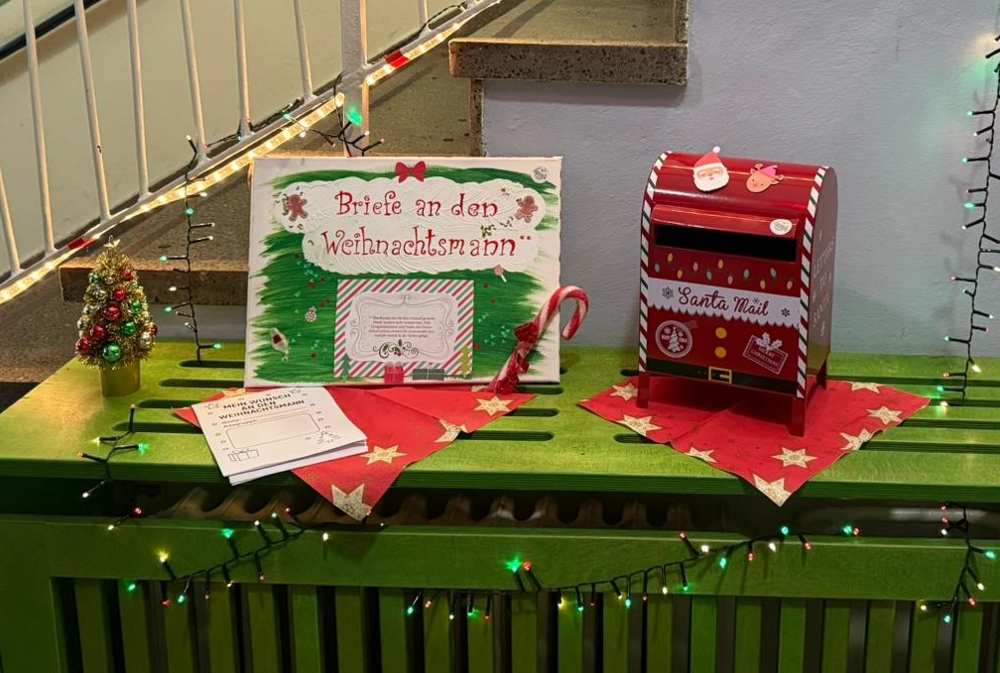
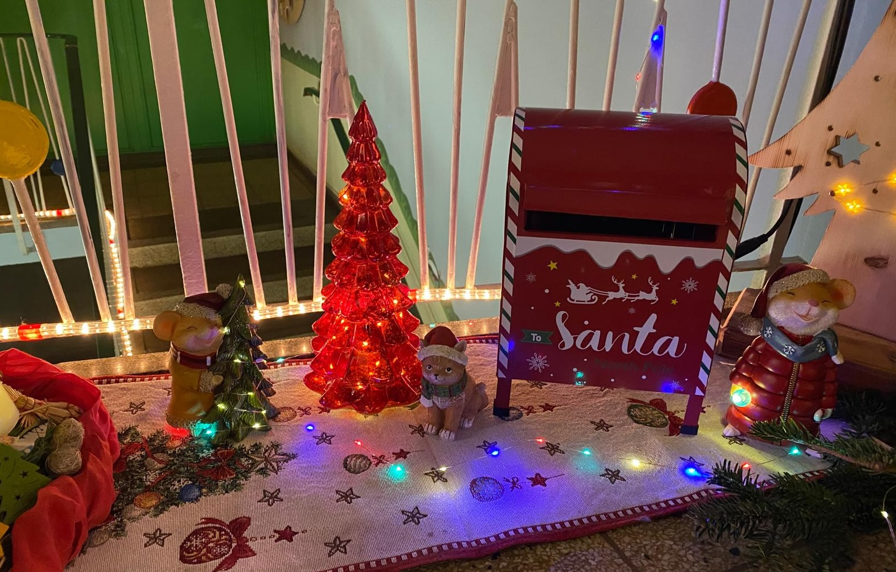

Die Weihnachtszeit rückt näher und bei unseren Pfeffermäusen wird es wieder spannend! 🐭🎄 Vom 23. November bis zum 4. Dezember 2026 können die Kinder ihre Briefe, Wunschzettel und selbstgemalten Bilder an den Weihnachtsmann in unsere festlich geschmückten Weihnachtsbriefkästen werfen.

📮 Zwei Weihnachtsbriefkästen für unsere kleinen Wunschzettelschreiber

Sowohl im Haus Grüne Trift als auch im Haus Nachtheide steht ein eigener Weihnachtsbriefkasten bereit. Die Wunschzettel liegen direkt an den Briefkästen zum Mitnehmen aus. Die Kinder können ihre Wunschzettel ganz entspannt zu Hause gestalten oder sie gemeinsam mit den Erzieher ausfüllen und bemalen. Diese sind über die Aktion informiert und unterstützen die Kinder gerne dabei. 🎨✏️

Ob ein großer Herzenswunsch, ein Lieblingsspielzeug oder einfach ein schönes Bild für den Weihnachtsmann – der Fantasie sind keine Grenzen gesetzt!

Damit die Briefe später auch bei den richtigen Familien ankommen, gibt es eine wichtige Bitte: Schreibt unbedingt den Namen des Kindes und den Namen seiner Kita-Gruppe auf den Wunschzettel. Nur so können wir die Briefe richtig zuordnen.

✉️ Der Weihnachtsmann schickt Post zurück!

Natürlich sollen die kleinen Wunschzettelschreiber nicht leer ausgehen: In der zweiten Dezemberwoche werden die Briefe in einem verschlossenen Umschlag an die Familien zurückgegeben. So könnt ihr gemeinsam mit euren Kindern nachlesen, was sie dem Weihnachtsmann geschrieben oder gemalt haben – und vielleicht wird der eine oder andere Wunsch ja Wirklichkeit. ❤️

✨ Mehr als nur ein Wunschzettel

Einen Brief an den Weihnachtsmann zu schreiben oder zu malen, gehört für viele Kinder einfach zur Adventszeit dazu. Es regt die Fantasie an, fördert Kreativität und Sprache und macht die Zeit bis Weihnachten ein bisschen aufregender.

Und natürlich steckt auch eine wichtige Botschaft darin: Nicht jeder Wunsch kann in Erfüllung gehen. Aber gemeinsam zu träumen, Wünsche aufzuschreiben und sich auf Weihnachten zu freuen, ist schon etwas ganz Besonderes.

🎄 Der Förderverein freut sich, diese schöne Tradition auch in diesem Jahr wieder möglich zu machen. Wir sind gespannt, welche kleinen und großen Wünsche in unseren Briefkästen landen, und wünschen allen Kindern viel Freude beim Gestalten ihrer Weihnachtspost!

Euer Förderverein Kneipp-Kita Pfeffermäuse e. V. 🐭🩶

